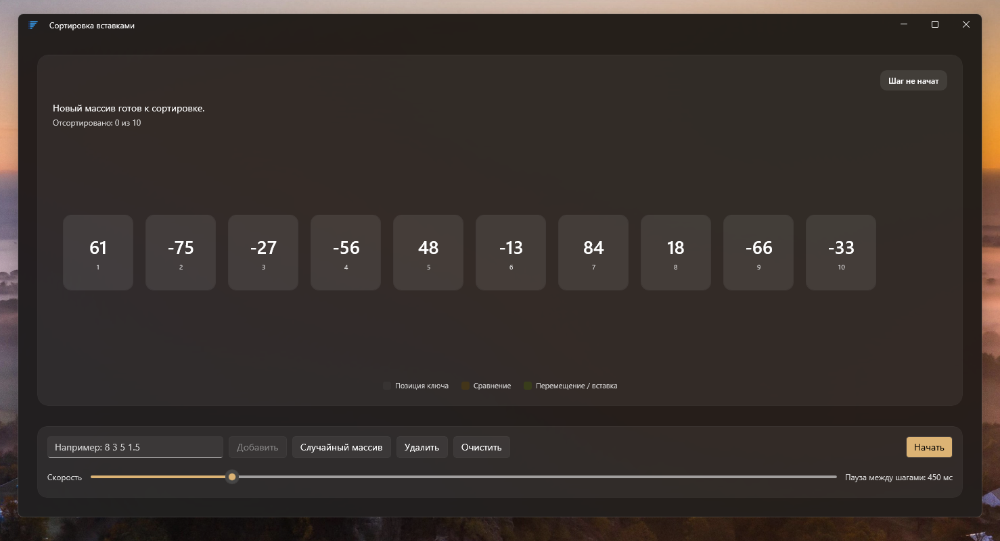
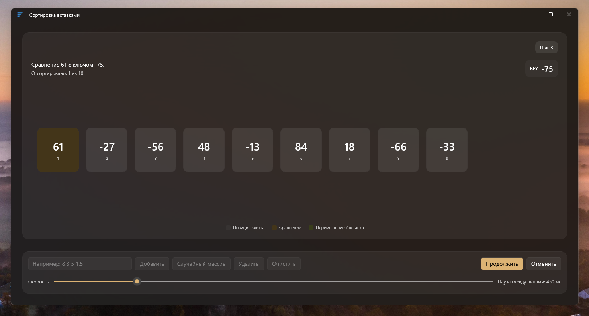
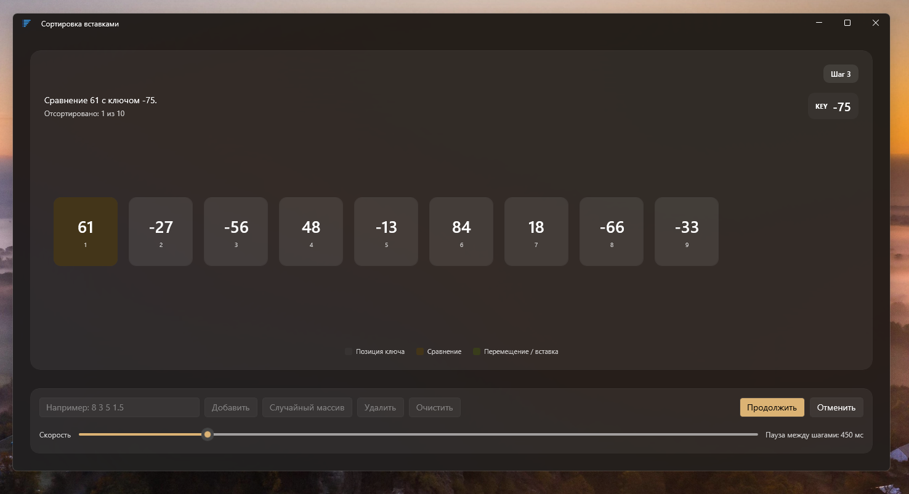
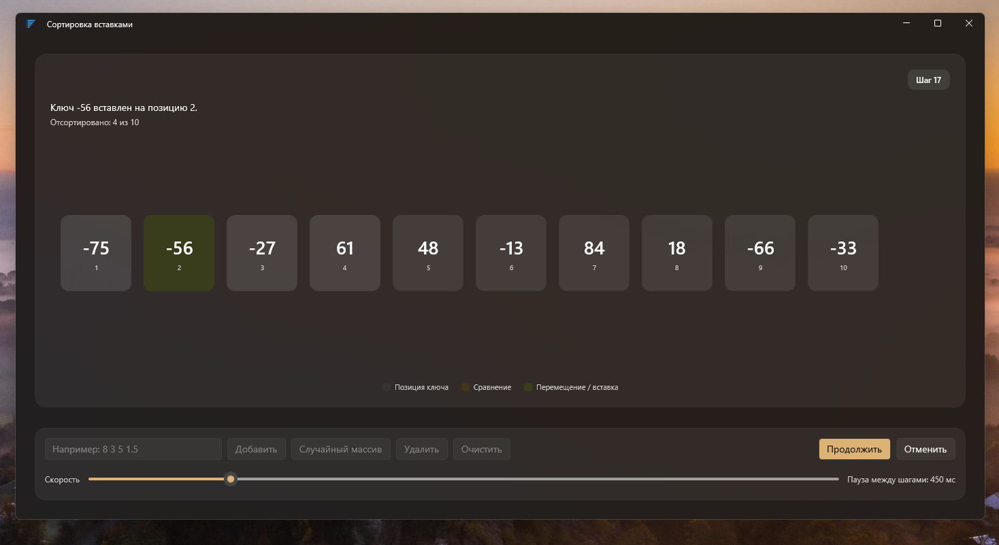
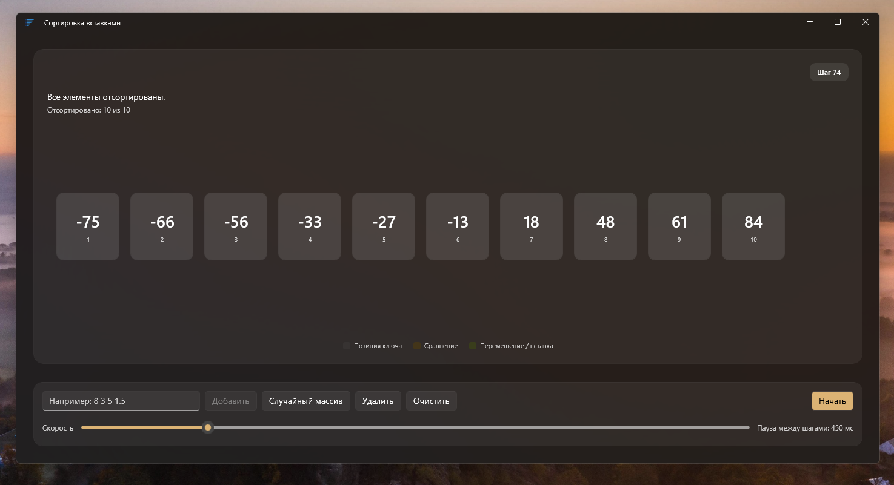

# Insertion Sort

Небольшое настольное приложение для Windows, которое визуализирует работу алгоритма сортировки вставками. Проект создан на **C#**, **.NET 10** и **WinUI 3** и работает в режиме **Unpackaged** — без установки и запуска через MSIX-пакет.

Приложение позволяет вводить числа, запускать сортировку и наблюдать за каждым её этапом. Во время обработки очередной элемент извлекается из горизонтального ряда, отображается отдельно как ключ (**KEY**), а после сравнений вставляется на найденную позицию. Перемещения элементов сопровождаются анимациями WinUI 3. Окно использует Mica backdrop и системные ресурсы темы Windows.

<!-- Скриншот 1: главное окно приложения с заполненным массивом до начала сортировки. Желательно использовать 5–8 разных чисел, чтобы были видны все карточки, поле ввода и кнопки управления. Сохранить как docs/screenshots/insertion-sort-main.png. -->

## Возможности

- **Ввод чисел** — добавление целых и дробных чисел через пробел или точку с запятой.
- **Проверка ввода** — приложение принимает только конечные числовые значения и сообщает о некорректных элементах.
- **Случайный массив** — добавление десяти случайных целых чисел в диапазоне от -100 до 100.
- **Управление массивом** — добавление значений, удаление последнего элемента и очистка последовательности.
- **Горизонтальная визуализация** — все числа располагаются строго в одну строку; если последовательность не помещается в окне, доступна горизонтальная прокрутка.
- **Извлечение ключа** — очередное число временно удаляется из ряда и показывается в отдельной области KEY.
- **Сравнение и перемещение** — приложение последовательно сравнивает ключ с элементами отсортированной части и визуально показывает выполняемые операции.
- **Анимированная вставка** — после определения позиции ключ возвращается в массив, а соседние элементы освобождают для него место с помощью переходов WinUI 3.
- **Пошаговое воспроизведение** — сортировку можно приостановить и продолжить с того же этапа.
- **Отмена сортировки** — при отмене исходная последовательность восстанавливается.
- **Настройка скорости** — интервал между шагами можно изменять от 100 до 2000 мс; значение по умолчанию — 450 мс.
- **Устойчивая сортировка** — одинаковые значения сохраняют взаимный порядок.

## Примеры работы

<!-- Скриншот 2: сортировка приостановлена сразу после выбора очередного ключа. Число должно быть видно в отдельном блоке KEY и отсутствовать в горизонтальном ряду. Сохранить как docs/screenshots/insertion-sort-key.png. -->

<!-- Скриншот 3: сортировка приостановлена на этапе сравнения. На экране должны быть видны ключ и выделенный сравниваемый элемент. Сохранить как docs/screenshots/insertion-sort-comparison.png. -->

<!-- Скриншот 4: этап вставки ключа в отсортированную часть массива. Желательно поймать момент после вставки, когда ключ выделен цветом вставки, а карточки уже заняли новые позиции. Сохранить как docs/screenshots/insertion-sort-insertion.png. -->

<!-- Скриншот 5: завершённая сортировка. Все числа расположены по возрастанию, блок KEY скрыт, отображается сообщение о завершении. Сохранить как docs/screenshots/insertion-sort-completed.png. -->

## Технологический стек

| Технология                    | Использование                                               |
| ----------------------------- | ----------------------------------------------------------- |
| C#                            | Язык программирования                                       |
| .NET 10                       | Целевая платформа приложения                                |
| WinUI 3                       | Нативный пользовательский интерфейс Windows                 |
| Windows App SDK               | API и компоненты WinUI 3                                    |
| XAML                          | Разметка интерфейса                                         |
| MVVM                          | Разделение представления и логики приложения                |
| ObservableCollection          | Коллекции исходных значений и отображаемых элементов        |
| INotifyPropertyChanged        | Уведомление интерфейса об изменениях ViewModel              |
| ICommand                      | Команды управления из ViewModel                             |
| Task и CancellationToken      | Асинхронное воспроизведение, пауза и отмена сортировки       |
| WinUI Theme Transitions       | Анимация удаления, добавления и перемещения карточек        |

Проект настроен как **Unpackaged WinUI 3 application**:

- Target Framework: `net10.0-windows10.0.26100.0`
- Минимальная версия Windows: `10.0.17763.0`
- Поддерживаемые архитектуры: `x86`, `x64`, `ARM64`
- MSIX-пакетирование отключено через свойство `WindowsPackageType` со значением `None`.

## Архитектура

В проекте используется MVVM без стороннего MVVM-фреймворка. Уведомления об изменениях свойств и команды реализованы непосредственно в проекте. Главное представление создано как `UserControl` и размещается непосредственно в окне — навигация через `Frame` не используется.

    InsertionSort/
    ├── Algorithms/
    │   └── InsertionSortAlgorithm.cs
    ├── Assets/
    │   ├── AppIcon.ico
    │   └── ...
    ├── Converters/
    │   └── BooleanToVisibilityConverter.cs
    ├── Infrastructure/
    │   ├── ObservableObject.cs
    │   └── RelayCommand.cs
    ├── Models/
    │   ├── SortStep.cs
    │   └── SortStepKind.cs
    ├── Properties/
    │   └── launchSettings.json
    ├── ViewModels/
    │   ├── MainViewModel.cs
    │   └── SortCellViewModel.cs
    ├── App.xaml
    ├── App.xaml.cs
    ├── MainWindow.xaml
    ├── MainWindow.xaml.cs
    ├── MainPage.xaml
    ├── MainPage.xaml.cs
    ├── InsertionSort.csproj
    ├── Package.appxmanifest
    ├── app.manifest
    └── README.md

### Ответственность компонентов

- **MainPage.xaml** — визуальное представление приложения: горизонтальный ряд чисел, текущий ключ, описание операции, легенда состояний, ввод данных и кнопки управления воспроизведением.
- **MainPage.xaml.cs** — создание `MainViewModel` и установка `DataContext`. Логика алгоритма в code-behind не размещается.
- **MainViewModel** — состояние приложения, исходная коллекция и отображаемые ячейки, проверка ввода, команды добавления и удаления значений, запуск сортировки, пауза, продолжение и отмена воспроизведения.
- **InsertionSortAlgorithm** — реализация устойчивой сортировки вставками. Генерирует последовательность неизменяемых снимков состояния массива для каждого шага алгоритма.
- **SortStep** — снимок одного шага сортировки: тип операции, состояние значений, количество отсортированных элементов, текущий ключ и индексы сравнения или перемещения.
- **SortStepKind** — перечисление типов операций: начальное состояние, выбор ключа, сравнение, сдвиг, вставка и завершение.
- **SortCellViewModel** — состояние отдельной карточки в визуализации: значение, позиция и признаки сравнения, сдвига, вставки или принадлежности к отсортированной части.
- **ObservableObject** — базовая реализация `INotifyPropertyChanged` и вспомогательного метода `SetProperty`.
- **RelayCommand** — простая реализация `ICommand` с поддержкой проверки возможности выполнения команды.
- **BooleanToVisibilityConverter** — преобразование логического значения в `Visibility.Visible` или `Visibility.Collapsed`.
- **MainWindow.xaml** — заголовок главного окна и Mica backdrop; содержит `MainPage` напрямую.
- **MainWindow.xaml.cs** — создание окна, настройка пользовательской строки заголовка и установка иконки приложения.

### Как работает сортировка

1. Алгоритм копирует исходную последовательность и проверяет, что все значения конечны. Исходная коллекция интерфейса не изменяется во время вычисления шагов.
2. Первый элемент считается отсортированной частью массива.
3. Очередной элемент выбирается как ключ (**KEY**) и временно удаляется из горизонтального ряда. Освободившееся место не отображается как отдельная карточка.
4. Ключ сравнивается с элементами отсортированной части справа налево. Если очередной элемент больше ключа, алгоритм сдвигает его на одну позицию вправо.
5. Когда найдено подходящее место, ключ вставляется обратно в ряд. Коллекция отображения удаляет и добавляет карточку, а WinUI 3 анимирует изменение расположения элементов.
6. Шаги повторяются, пока вся последовательность не будет отсортирована по возрастанию. При успешном завершении отсортированные значения записываются в исходную коллекцию.
7. При отмене сортировки исходная коллекция остаётся без изменений, а визуализация восстанавливается из неё.

Для сохранения устойчивости алгоритм сдвигает элементы только тогда, когда они **строго больше** ключа. Поэтому равные значения не меняются местами относительно друг друга.

Временная сложность классического Insertion Sort составляет **O(n²)** в среднем и худшем случае и **O(n)** в лучшем случае — для уже отсортированной последовательности. Дополнительная память алгоритма составляет **O(n)**.

## Требования

Для сборки проекта необходимы:

- Windows 10 или Windows 11.
- **.NET 10 SDK**.
- Windows SDK и компоненты сборки, необходимые для WinUI 3.
- Доступ к NuGet для восстановления пакетов, перечисленных в `InsertionSort.csproj`.

В проекте используются следующие NuGet-пакеты (версии и условия подключения задаются в `InsertionSort.csproj`):

- Microsoft.Windows.SDK.BuildTools
- Microsoft.WindowsAppSDK
- Microsoft.Windows.SDK.BuildTools.WinApp

## Сборка и запуск

Клонируй репозиторий:

    git clone https://github.com/Zaka22k/insertion-sort.git
    cd insertion-sort

Восстанови зависимости и собери приложение:

    dotnet restore .\InsertionSort.csproj
    dotnet build .\InsertionSort.csproj -c Debug

Запусти приложение:

    dotnet run --project .\InsertionSort.csproj

Также проект можно открыть в Visual Studio с установленной поддержкой WinUI 3 и запускать из IDE.
